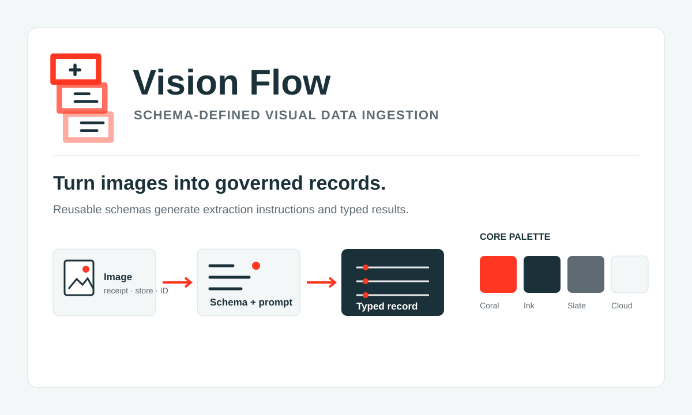

# Package 01: Flow Stack

## Direction

Flow Stack presents Vision Flow as a reusable path from visual input to governed table data. It is the closest of the three packages to Databricks in tone: coral red, dark technical neutrals, compact typography, and a layered mark. The mark uses a framed image at the top, a schema layer in the middle, and structured rows at the bottom.

This is the strongest general-purpose package for demos, architecture diagrams, and a Databricks App because it explains the product without tying the identity to one image type.

## Name and messaging

**Display name:** Vision Flow

**Descriptor:** Schema-defined visual data ingestion

**Primary line:** Turn images into governed records.

**Short description:** Vision Flow generates extraction prompts from reusable schemas, processes images with vision models, and stores typed results for review and analysis on Databricks.

**Demo introduction:** Define the fields once. Vision Flow creates or reuses the extraction schema, validates each image, and writes versioned results into a shared data model.

## Logo system

The mark consists of three offset layers connected by a single vertical path:

- Top layer: visual input, shown as an open image frame.
- Middle layer: the versioned schema and generated extraction instructions.
- Bottom layer: rows of structured data.

The offset should move down and right to imply processing. Keep the mark geometric and flat. Do not add a camera lens, eye, sparkle, or literal database cylinder.

**Wordmark:** `Vision Flow`, two words, title case.

**Lockup:** mark on the left, wordmark on the right. Use a stacked lockup only below 220 px of available width.

**Clear space:** one internal row height of the mark on all sides.

**Small-size rule:** below 24 px, remove the internal row lines and retain the three-layer silhouette.

## Color palette

| Token | Hex | Use |
| --- | --- | --- |
| Flow Coral | `#FF3621` | Brand mark, primary action, selected state |
| Ember | `#C82D1B` | Hover and pressed states |
| Deep Ink | `#1B3139` | Wordmark, headings, dark surfaces |
| Slate | `#5F6B72` | Secondary text and diagram labels |
| Cloud | `#F4F7F8` | Page and panel background |
| White | `#FFFFFF` | Cards and reversed content |
| Review Amber | `#C97A00` | Review-required state only |
| Valid Green | `#168A57` | Accepted or completed state only |

Use Flow Coral for no more than roughly 15% of a product screen. Most screens should remain white or Cloud with Deep Ink text.

## Typography

**Preferred family:** DM Sans for the wordmark and headings; system UI or Nunito Sans for product copy.

**Practical repository option:** retain the current Nunito Sans stack for the application and use weight, size, and spacing to create hierarchy. This avoids adding a font dependency before the direction is approved.

- Wordmark: 700 weight, normal tracking.
- Page title: 700 weight, 28–32 px.
- Section heading: 700 weight, 16–20 px.
- Product copy: 400–600 weight, 14–16 px.
- Data labels: 600 weight, 12–13 px.

## Product UI application

- Keep the current dark camera surface and white controls.
- Change the main accent to Flow Coral and use it for capture-adjacent actions, active schema selection, and assistant entry points.
- Place a small Flow Stack mark beside `Vision Flow` in the scanner header.
- Represent the active schema as the middle layer in status diagrams and progress views.
- Use a five-step processing indicator: `Captured → Validated → Matched → Extracted → Stored`.
- Use Cloud panels with thin gray borders for schema settings and extraction results.

## Use-case language

| Use case | Label | Supporting line |
| --- | --- | --- |
| Lottery receipt scanning | Receipt data ingestion | Convert receipt images into typed transaction and game records. |
| Store layout auditing | Layout compliance records | Record placement, signage, and display findings from store images. |
| ID verification | Identity field extraction | Extract required identity fields and route uncertain records for review. |
| Forms and inspections | Operational image ingestion | Apply reusable field definitions to forms, labels, and inspection images. |

## Diagram style

Show the product as a left-to-right flow:

`Image → Schema match → Generated prompt → Vision model → Typed Delta record`

Use coral for the current step, Deep Ink for completed structure, and gray for supporting systems. Use small schema chips to show that the same path can process multiple categories.

## Voice

- Describe inputs, transformations, and outputs directly.
- Use `schema-defined`, `typed`, `versioned`, and `reviewable` when those properties are relevant.
- Prefer `image` over `document` because the product also handles store scenes and displays.
- Avoid claims that every result is verified. The product can validate required content and route uncertain results for review.

## Recommended asset set

- Horizontal and stacked logo lockups.
- Single-color favicon and application icon.
- Light and dark AppKit header variants.
- Architecture diagram components for image, schema, prompt, model, and table.
- Three use-case illustrations built from the same layered geometry.

