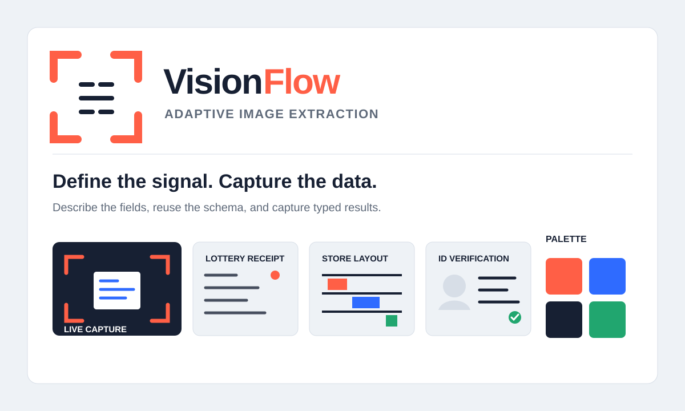

# Package 02: Signal Frame

## Direction

Signal Frame emphasizes the capture experience and the ability to define what the system should recognize. The mark combines four viewfinder corners with a small structured grid. The open center represents an adaptable field of view rather than a fixed document template.

This package is best when the live scanner is the main demo. It feels more like a standalone application while retaining Databricks coral, dense product layouts, and neutral surfaces.

## Name and messaging

**Display name:** VisionFlow

**Descriptor:** Adaptive image extraction

**Primary line:** Define the signal. Capture the data.

**Short description:** VisionFlow converts a plain-language field request into a reusable extraction schema, then applies it to images and scenes through one capture flow.

**Demo introduction:** Select a schema or describe a new one, point the scanner at the image, and receive typed fields that are ready for review and analysis.

## Logo system

The mark uses four framing corners around a two-column field grid:

- The corners refer to camera focus and image boundaries.
- The grid refers to fields and values, rather than generic pixels.
- The open gaps indicate that schemas can change without changing the ingestion flow.

Avoid adding crosshairs, face-recognition brackets, or surveillance references. The mark should communicate capture and structure without implying biometric tracking.

**Wordmark:** `VisionFlow`, one word. Set `Vision` in Deep Ink and `Flow` in Signal Coral when color is available.

**Lockup:** horizontal by default. The mark can stand alone as the capture button or favicon.

**Clear space:** the width of one corner stroke on all sides.

**Small-size rule:** below 24 px, reduce the center grid to two horizontal bars.

## Color palette

| Token | Hex | Use |
| --- | --- | --- |
| Signal Coral | `#FF5F46` | Brand mark, capture action, active focus |
| Databricks Red | `#D92D20` | Hover and high-emphasis action |
| Deep Ink | `#172033` | Wordmark, headings, camera chrome |
| Focus Blue | `#2F6BFF` | Schema field highlights and informational focus |
| Mist | `#EEF2F6` | Application background |
| White | `#FFFFFF` | Panels and camera controls |
| Focus Green | `#21A66F` | Valid image guide and success state |

Focus Blue separates schema definition from the coral capture action. It should not replace coral as the main brand color.

## Typography

**Preferred family:** Inter or Databricks Sans where licensed and available.

**Practical repository option:** continue with Nunito Sans for the product UI. Set the `VisionFlow` wordmark in a firmer 750–800 weight and tighten tracking slightly.

- Wordmark: 750–800 weight, `-0.02em` tracking.
- Product title: 700 weight, 24–30 px.
- Controls: 650–700 weight, 13–15 px.
- Field labels: 600 weight, 12–13 px.
- Values and descriptions: 400–500 weight, 14–16 px.

## Product UI application

- Use the Signal Frame mark as the scanner focus guide when idle.
- Keep the camera header compact: logo, schema selector, settings, and assistant action.
- Use Signal Coral for capture and schema creation. Use Focus Blue for editable field definitions and generated schema previews.
- After capture, animate the four corners inward once, then replace the camera layer with the validation state. Avoid continuous scanning effects.
- Display extracted output as a field/value grid so the UI repeats the center of the brand mark.
- Label uncertainty at field level when available instead of presenting only a document-wide score.

## Use-case language

| Use case | Label | Supporting line |
| --- | --- | --- |
| Lottery receipt scanning | Capture ticket sales data | Recognize game, jurisdiction, quantities, price, retailer, and transaction details. |
| Store layout auditing | Capture layout conditions | Identify product, shelf, display, and signage conditions from store images. |
| ID verification | Capture identity fields | Recognize required fields and flag missing or uncertain values for review. |
| Custom workflows | Define a new signal | Describe the fields to recognize and reuse the resulting schema on later images. |

## Diagram style

Use a central frame with three possible image inputs entering from the left and one normalized field grid leaving to the right. Place the schema definition above the frame as a compact control card.

`Receipt / Store / ID → Signal Frame → Typed fields`

This composition makes the reusable ingestion path clear without turning the vision model into the visual focus.

## Voice

- Use short action labels in the scanner: `Select schema`, `Capture image`, `Check fields`, `Open results`.
- Use `recognize` for the requested visual content and `extract` for the resulting values.
- Explain schema creation in user language first, with JSON or fingerprints available in technical details.
- Avoid personifying the model or describing image processing as sight, understanding, or judgment.

## Recommended asset set

- Horizontal `VisionFlow` wordmark with two-color and one-color versions.
- Signal Frame app icon and focus-guide variant.
- Field-grid result cards for the three reference use cases.
- Scanner loading, validation, accepted, and review-required motion states.
- Presentation title slide and mobile demo title card.

