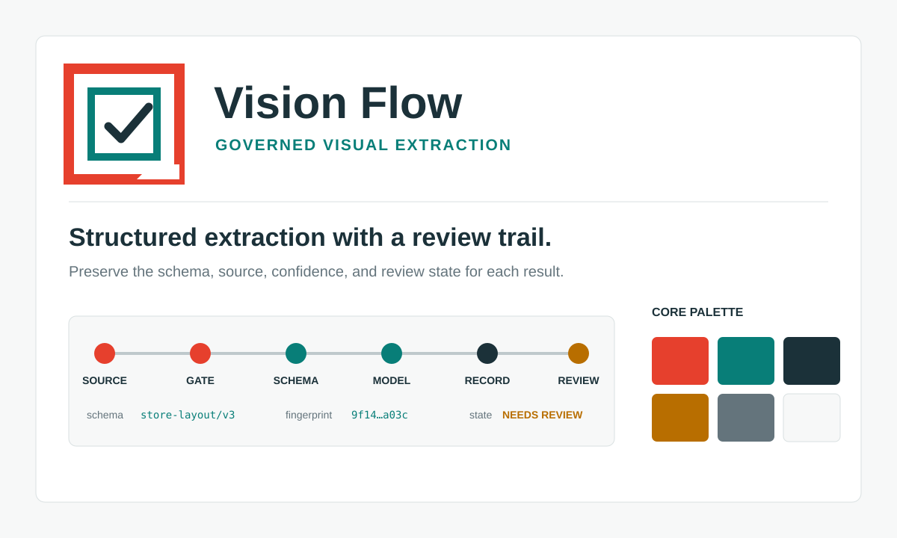

# Package 03: Verified Layer

## Direction

Verified Layer centers the product on traceability: each result is tied to a versioned schema, source image, confidence data, and review state. The mark combines a document or scene frame with a nested schema layer and a restrained check shape. The check means that required processing stages completed; it does not claim that every extracted value is correct.

This package is the strongest fit for ID verification, regulated workflows, audit programs, and enterprise buyers who need to understand how results can be traced and reviewed.

## Name and messaging

**Display name:** Vision Flow

**Descriptor:** Governed visual extraction

**Primary line:** Structured extraction with a review trail.

**Short description:** Vision Flow converts images into typed records and preserves the schema version, source metadata, confidence, and review state used for each result.

**Demo introduction:** Each image is checked against the selected category, processed with schema-constrained instructions, and stored with the context required to review and analyze the result.

## Logo system

The mark uses two nested rectangular layers and a short check path:

- Outer layer: the source image and its boundary.
- Inner layer: the extraction contract applied to the image.
- Check path: completed validation and processing stages.

The nested rectangles should remain open on one edge so the mark does not resemble a security badge. Avoid shields, locks, fingerprints, faces, or government-seal motifs.

**Wordmark:** `Vision Flow`, two words. Use a small uppercase descriptor below the wordmark in formal material.

**Lockup:** horizontal for the application; stacked mark, wordmark, and descriptor for compliance documents.

**Clear space:** half the mark width on all sides.

**Small-size rule:** below 24 px, remove the inner border and retain the outer frame plus check path.

## Color palette

| Token | Hex | Use |
| --- | --- | --- |
| Assurance Coral | `#E6402D` | Brand mark and primary action |
| Deep Ink | `#1B3139` | Wordmark, headings, dark header |
| Governed Teal | `#087E78` | Schema version, governed state, informational status |
| Review Amber | `#B86E00` | Human review required |
| Failure Red | `#BA1A1A` | Validation or processing failure only |
| Steel | `#64747C` | Metadata and supporting labels |
| Porcelain | `#F7F8F8` | Page background |
| White | `#FFFFFF` | Cards and reverse lockup |

Use Governed Teal only for traceability and schema context. Do not use it as a generic success color; completion and confidence are separate concepts.

## Typography

**Preferred family:** IBM Plex Sans for headings and IBM Plex Mono for fingerprints, schema versions, and record identifiers.

**Practical repository option:** retain Nunito Sans for the application and introduce the platform monospace stack only for technical metadata.

- Wordmark: 700 weight, normal tracking.
- Descriptor: 700 weight, 11–12 px, `0.08em` tracking.
- Page title: 700 weight, 26–30 px.
- Product copy: 400–600 weight, 14–16 px.
- Metadata: 500 weight, 12–13 px monospace.

## Product UI application

- Add a compact result-trace panel after extraction with schema name, version, fingerprint, source time, confidence, and review state.
- Use neutral cards and table-like rows rather than celebratory success screens.
- Reserve the check shape for completed pipeline stages. Use explicit labels such as `Accepted`, `Needs review`, and `Rejected` for the result state.
- Use coral for primary actions, teal for schema metadata, amber for review queues, and red for failures.
- Keep the camera focus guide white or green. Do not turn it teal unless it is showing schema-bound metadata.
- In AI/BI dashboards, separate processing health, extraction confidence, and business findings into different visual groups.

## Use-case language

| Use case | Label | Supporting line |
| --- | --- | --- |
| Lottery receipt scanning | Traceable receipt extraction | Store typed receipt fields with the schema and source context used to produce them. |
| Store layout auditing | Reviewable compliance findings | Record layout findings and route incomplete or uncertain images to an audit queue. |
| ID verification | Governed identity extraction | Extract required identity fields and retain the metadata needed for review. |
| Inspection records | Versioned operational records | Preserve the extraction contract used for every image-derived record. |

## Diagram style

Use a vertical trace with an evidence rail:

`Source image → Image gate → Schema version → Model response → Typed record → Review state`

Display the schema fingerprint and timestamps on the evidence rail. Use thin connector lines and labeled state chips. Avoid large lock icons or security imagery that implies guarantees outside the product's actual behavior.

## Voice

- Distinguish `processed`, `accepted`, `high confidence`, and `verified`; they are not interchangeable.
- State what metadata is retained and how a record can be reviewed.
- Use `governed` only when referring to concrete Databricks controls or stored lineage context.
- Avoid `fraud-proof`, `fully automated verification`, and other unsupported assurance claims.

## Recommended asset set

- Horizontal and compliance-document lockups.
- One-color favicon and audit-report watermark.
- Result-trace panel component and review-state chips.
- Architecture diagram with evidence rail.
- AI/BI dashboard title treatment for processing health and review queues.

