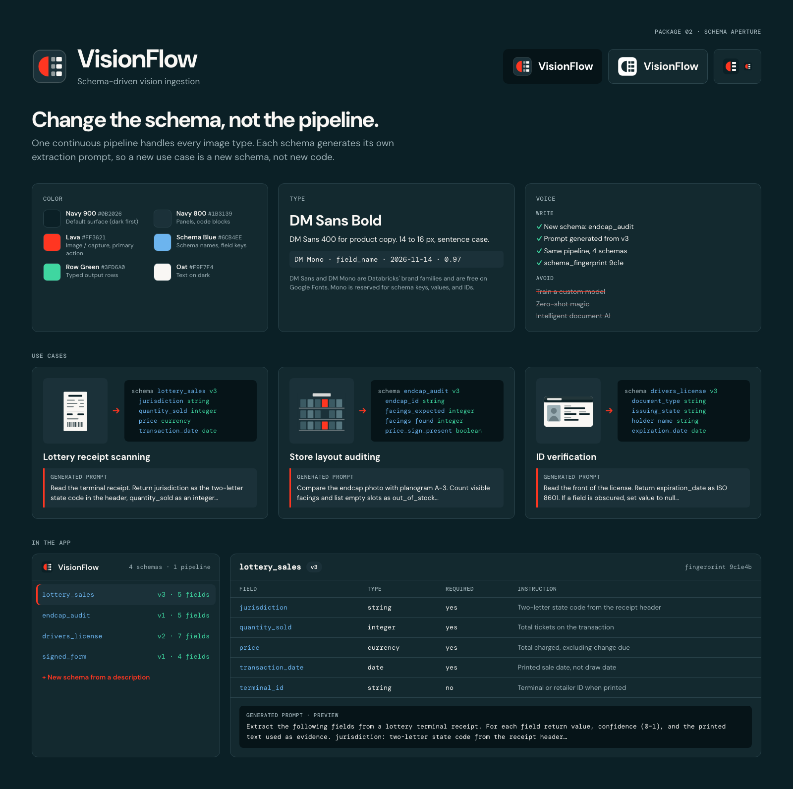

# 02 Schema Aperture

## Concept

What sets this project apart from OCR is the schema. A user describes a new image type, Vision Flow creates a versioned JSON schema, and the extraction prompt is generated from that schema. The pipeline itself never changes. Adding a use case means adding a schema, not writing code.

The mark puts both halves of that idea in one tile: a lens on the left (Lava half disc) and a table on the right (two columns, three rows, with the key column dimmer than the value column). The flat edge of the lens faces the table. Light goes in one side, rows come out the other.

This package is dark-first and leans on DM Mono. Schema names, versions, field keys, types, and fingerprints are a visible part of the brand, not hidden implementation details.

## Messaging

| | |
| --- | --- |
| Name | VisionFlow |
| Descriptor | Schema-driven vision ingestion |
| Tagline | Change the schema, not the pipeline. |
| One line | VisionFlow generates vision-model prompts from versioned schemas, so one pipeline can ingest any image type. |
| Short description | One continuous pipeline handles every image type. Each schema generates its own extraction prompt, so a new use case is a new schema, not new code. |
| Demo opener | "This pipeline has been running all week. I'm going to add a new use case, store endcap audits, without touching it. I describe the image, VisionFlow writes schema v1, and the next photo comes back as a row." |

**Boilerplate (50 words).** VisionFlow is a schema-driven ingestion pattern for vision models on Databricks. Each image type is a versioned JSON schema stored in Lakebase; VisionFlow generates the extraction prompt from it and runs every type through one continuous Lakeflow pipeline. Results land in a single Delta table, each row tagged with its schema fingerprint, ready for Genie.

### Use-case lines

Lead with the schema name. It makes the point that each use case is just configuration.

| Schema | Headline | Supporting line |
| --- | --- | --- |
| `lottery_sales` | Lottery receipt scanning | Five fields, one schema, every terminal format. |
| `endcap_audit` | Store layout auditing | Facings, empty slots, and signage against planogram A-3. |
| `drivers_license` | ID verification | Required fields and expiration, with nulls instead of guesses. |
| `signed_form` | Forms | Added from a one-sentence description. |

### Words

- Say *schema*, *version*, *field*, *prompt*, *fingerprint*, *row*. These are real objects in the system.
- Say "generated prompt", not "AI prompt". The prompt is derived from the schema; that's the feature.
- Don't say "train". Nothing is trained.

## Logo

**Construction (64 px grid).** Rounded tile, 60 px, 14 px radius, Navy 900. Lava half disc, radius 18, centered at (30, 32), flat edge facing right. Grid of six cells starting at x = 35: key column 7 px wide at 55% Oat, value column 10 px wide at full Oat; rows 8 px tall at y = 15, 28, 41.

**Variants.**

- `mark.svg`: Navy 900 tile. Light backgrounds and app icon.
- `mark-reversed.svg`: Navy 800 tile with a faint Oat outline, so the tile edge survives on a Navy 900 page.
- `mark-mono.svg`: solid tile with the disc and cells cut out (uses `currentColor` and a mask).
- `favicon.svg`: half disc plus three bars instead of six cells. Use at 32 px and below.

**Lockup.** Tile left, `VisionFlow` right in DM Sans Bold, one word, capital V and F. Don't put a space or change the color of "Flow".

**Clear space.** A quarter of the tile width on every side.

**Minimum size.** Tile 20 px; favicon below that. Lockup 110 px wide.

**Don't.** Mirror the mark (the lens is always on the left, input side). Use a full circle. Add more rows or columns. Put the tile on Lava.

## Color

| Token | Hex | Use |
| --- | --- | --- |
| Navy 900 | `#0B2026` | Default app surface |
| Navy 800 | `#1B3139` | Panels, code and prompt blocks |
| Navy 700 | `#13292F` | Raised surfaces, cards |
| Line | `#2A434B` | Borders on dark |
| Oat | `#F9F7F4` | Text on dark |
| Muted | `#9DB0B6` | Secondary text on dark (7.5:1) |
| Lava | `#FF3621` | Images, capture, primary action |
| Schema Blue | `#6CB4EE` | Schema names and field keys on dark. Use `#2272B4` on light. |
| Row Green | `#3FD6A0` | Types and typed output on dark. Use `#00875A` on light. |
| Amber | `#FFC24D` | Needs review on dark |

The three accents map to the three stages: Lava is the image, Blue is the schema, Green is the row. Keep that mapping in every diagram and screen.

## Type

- DM Sans Bold for the wordmark and headings, 400 and 500 for copy.
- DM Mono for every schema-level object: schema names, versions, field keys, types, generated prompt text, fingerprints. Lowercase, `snake_case`, as stored.
- Section labels in DM Mono 11 px uppercase with 5% tracking.

## In the current app

1. App chrome switches to Navy 900; `--camera-surface` already is close (`#161D29`). `tokens.css` sets it to `#0B2026`.
2. The schema selector becomes a first-class panel: a list of schemas with version and field count, and "New schema from a description" at the bottom in Lava.
3. The schema detail view shows the field table (field, type, required, instruction) and a read-only generated prompt preview beneath it. This is the screen to demo.
4. Show `schema_fingerprint` in results and in the review screen. It's what ties a row to the exact instructions that produced it.
5. Use `mark.svg` as the PWA icon. The tile shape is already app-icon ready.

## Diagrams

Three lanes, left to right: Image (Lava), Schema (Blue), Row (Green). The Schema lane shows the schema registry in Lakebase and a generated prompt coming off it. The pipeline box sits once in the middle, labeled "Lakeflow, continuous, unchanged". Draw multiple schemas feeding the same pipeline box; that picture is the whole pitch.

## Open questions

- Dark-first is right for the camera and for demos on a projector. Docs and AI/BI dashboards are light, so the light-mode values (Blue `#2272B4`, Green `#00875A`) need a real pass.
- A schema-first brand speaks to builders. For an operator-facing deployment (store staff scanning shelves), the app might show the 01 treatment while the platform keeps this one.
