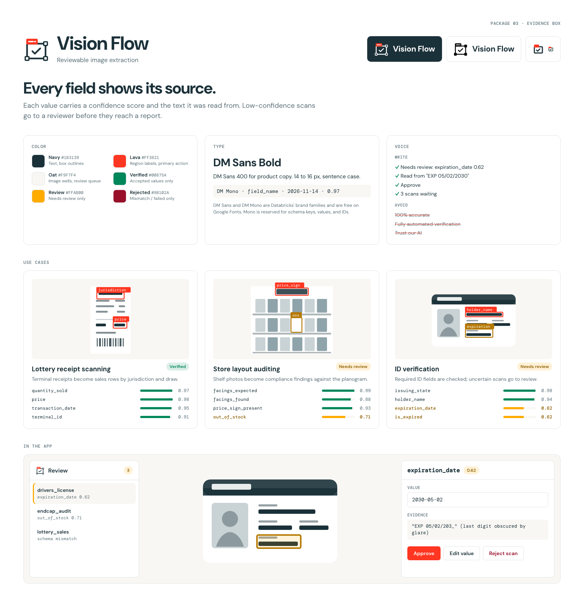

# 03 Evidence Box

## Concept

In ID checks and store audits, the useful question isn't "what did the model read" but "should I trust it". Vision Flow already answers that per field: every value is stored with a `confidence` score and the `evidence` text it came from, and a scan gets `needs_review` when a required field is missing, confidence is low, or the image doesn't match the schema.

This package makes that visible. The mark is an annotation bounding box, the shape people know from labeling tools, with a Lava label tab, three resize handles, and a check inside. It says "a region was found, labeled, and checked".

## Messaging

| | |
| --- | --- |
| Name | Vision Flow |
| Descriptor | Reviewable image extraction |
| Tagline | Every field shows its source. |
| One line | Vision Flow extracts fields from images with a confidence score and evidence for each, and sends uncertain scans to review. |
| Short description | Each value carries a confidence score and the text it was read from. Low-confidence scans go to a reviewer before they reach a report. |
| Demo opener | "This license came back with expiration_date at 0.62. Glare hid the last digit. Vision Flow didn't guess quietly: it flagged the field, kept the text it read, and put it in front of a reviewer." |

**Boilerplate (50 words).** Vision Flow extracts structured data from images on Databricks and keeps the receipts. Every field is stored with its value, a confidence score, and the text it was read from. Scans with missing fields, low confidence, or a schema mismatch are flagged for review, so reports only count values someone can trace.

### Use-case lines

| Use case | Headline | Supporting line |
| --- | --- | --- |
| ID verification | Checked, not guessed | Required fields and expiration with confidence per field. Obscured values go to review as null or low confidence. |
| Store layout auditing | Findings you can point to | Each missing facing or sign is a finding with the evidence that produced it. |
| Lottery receipt scanning | Sales you can reconcile | Every amount traces to the printed line it came from. |

### Words

- Say *confidence*, *evidence*, *needs review*, *approve*, *reject*. Show the number (`0.62`), not "low".
- Confidence is a model self-assessment, not a calibrated probability. Never present it as a percentage accuracy.
- Don't say "verified identity". Vision Flow checks document fields; identity verification is a larger process.

## Logo

**Construction (64 px grid).** Box 45 × 36 at (9, 19), 4 px Navy stroke, 3 px radius. Lava tab 28 × 14 at (7, 7), overlapping the box's top-left corner, with a white label line and a short second segment (a label and its value). Handles: 9 px white squares with 3 px Navy stroke on the other three corners. Check mark centered in the box, 4 px stroke.

**Variants.**

- `mark.svg`: Navy box, Lava tab. Light backgrounds.
- `mark-reversed.svg`: white box and check, Navy handle fills.
- `mark-mono.svg`: one color. Handles become solid squares and the tab label is knocked out.
- `favicon.svg`: box, tab, and check only; handles removed. White tile so it stays legible in dark browser tabs.

**Lockup.** Mark left, "Vision Flow" right in DM Sans Bold, two words.

**Clear space.** One handle width (9/64 of the mark) on every side.

**Minimum size.** 24 px; favicon below that.

**Don't.** Move the tab to another corner (top-left is the labeling convention). Use dashed box strokes in the mark (dashes are reserved for "expected but missing" in product imagery). Recolor the check green; green means "verified" in the product and the mark isn't a status.

## Color

| Token | Hex | Use |
| --- | --- | --- |
| Navy | `#1B3139` | Text, box outlines |
| Slate | `#5A6F77` | Secondary text |
| White | `#FFFFFF` | Main surface |
| Oat | `#F9F7F4` | Image wells, review queue background |
| Line | `#E0E3E5` | Borders |
| Lava | `#FF3621` | Region labels, primary action |
| Verified | `#00875A` | Accepted values and bars |
| Review fill | `#FFAB00` | Confidence bars and region fill for needs-review |
| Review text | `#8F5F00` | Needs-review labels (5.5:1 on white) |
| Rejected | `#98102A` | Mismatch, failure, reject action |

This package has the most color, so the rule is strict: green, amber, and maroon appear only as status. If a screen has no status to show, it is Navy, white, and Lava.

## Type

- DM Sans for UI. DM Mono for field names, values, confidence numbers, and evidence quotes.
- Evidence text is always shown in quotes, exactly as returned: `"EXP 05/02/203_"`.

## In the current app

1. Add a review queue: scans with `needs_review = true`, each row showing the schema and the lowest-confidence field (`expiration_date 0.62`).
2. Review detail: the image, then value (editable), evidence (read-only), and Approve, Edit value, Reject scan. Lava primary, ghost secondary, maroon text for reject.
3. In results, render one confidence bar per field: green at or above the review threshold, amber below.
4. Region boxes on the image need coordinates. Today `evidence` is `string | null` in `schema-contract.ts`. Two options:
   - Add an optional `region: { x, y, w, h }` (normalized 0 to 1) to the field envelope and ask the model for it. Vision models are inconsistent at this, so treat boxes as hints.
   - Keep boxes out of the product and use them only in marketing imagery. The confidence and evidence treatment still carries the brand.

## Diagrams

Draw the image with labeled boxes on it, and a line from each box to its row in the output table. Amber boxes and amber rows for fields under the threshold, with a fork to "Review" before "Report".

## Open questions

- The brand promises traceability. Before using it externally, confirm the evidence text is good enough to show a reviewer (does it quote the printed text, or paraphrase?).
- It undersells the dynamic-schema story. Pair it with the 02 language when the audience is technical.
