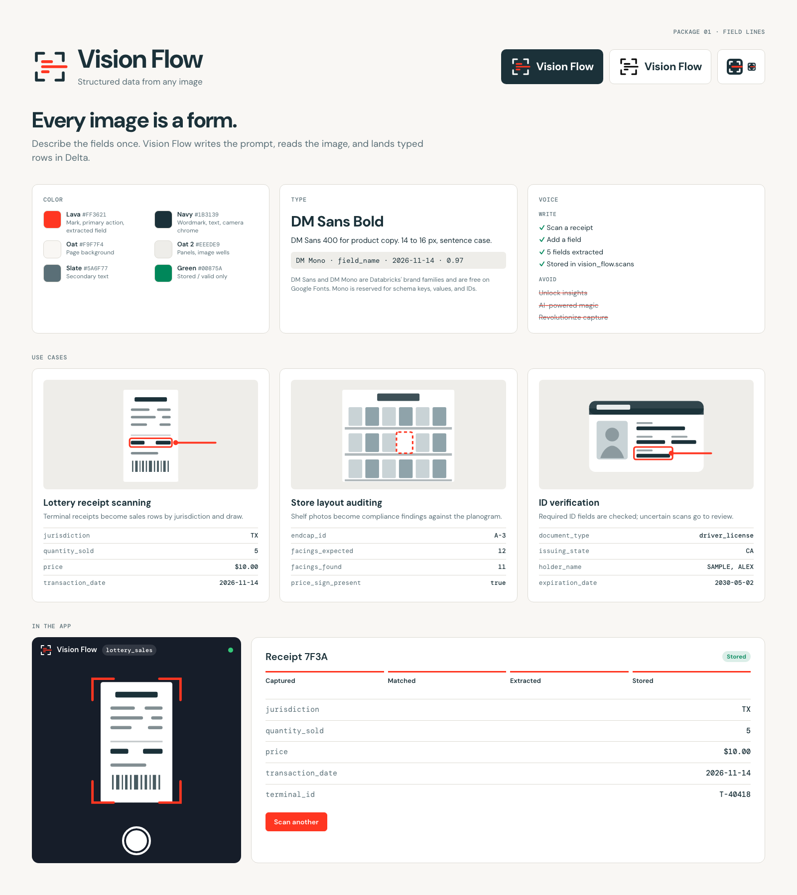

# Vision Flow branding, v2 (research)

> Outcome: package 01 Field Lines was adopted. Its guide, board, and assets moved to [`docs/branding`](../../branding/README.md) and `packages/app/client/public/brand`. Packages 02 and 03 remain here for reference.

Three branding packages for Vision Flow. Each package has a working logo set (color, reversed, single-color, favicon), CSS tokens that map onto the current scanner styles, a rendered concept board, and a written guide.

All three use the Databricks visual system: Lava `#FF3621` on Navy `#1B3139` and Oat `#F9F7F4`, DM Sans and DM Mono, flat surfaces, thin borders. None of them reuse or modify the Databricks stacked-layer symbol, so the Vision Flow mark can sit next to it in a deck or app header.

| | Package | Name | Leads with | Line |
| --- | --- | --- | --- | --- |
|  | [01 Field Lines](../../branding/README.md) | Vision Flow | Extraction: images become rows | Every image is a form. |
|  | [02 Schema Aperture](02-schema-aperture/README.md) | VisionFlow | Dynamic prompts: one pipeline, many schemas | Change the schema, not the pipeline. |
|  | [03 Evidence Box](03-evidence-box/README.md) | Vision Flow | Trust: confidence, evidence, review | Every field shows its source. |



## How they differ

**01 Field Lines** is the broadest. The mark is a camera viewfinder with three extracted field lines inside, and the middle line exits the frame. It reads as "scan, then data" to anyone, works on the current dark camera surface with almost no UI change, and suits all three use cases equally. Light, warm Oat backgrounds, close to Databricks marketing pages.

**02 Schema Aperture** is the most specific to what makes this project different: the schema is the product and prompts are generated from it. The mark is a tile split into a lens (half disc) and a table (grid). Dark-first, with mono type carrying a lot of the identity (`lottery_sales v3`, field keys, fingerprints). It fits a technical audience and architecture demos best. It's the weakest for a non-technical store auditor or ID-check operator.

**03 Evidence Box** leads with governance. The mark is an annotation bounding box with a label tab and a check. It's the natural fit for ID verification and audits, where the question is "can I trust this value". It relies on the field envelopes the pipeline already writes (`value`, `confidence`, `evidence`) and the `needs_review` flag. One caveat: `evidence` is currently a text string, not image coordinates, so the bounding boxes on the board are illustrative. Shipping this brand as drawn would mean adding region coordinates to the field envelope, or drawing boxes only in marketing and not in the product.

## Recommendation

Use **01 Field Lines** as the product brand, and borrow from the others by context:

- Use 02's schema language and mono styling inside the schema editor and in architecture slides, where "change the schema, not the pipeline" is the point being made.
- Use 03's review treatment (confidence bars, evidence block, semantic status colors) for the review queue and the ID verification demo.

This works because all three share the same palette and type. Only the mark and the emphasis change.

If you would rather have one sharp idea than a broad one, pick 02. It is the only package whose tagline could not apply to a generic OCR product.

## Naming

- **Vision Flow** (two words) reads naturally in sentences and matches the current README and app header. Used by 01 and 03.
- **VisionFlow** (one word) is a tighter wordmark and an easier handle (`visionflow`, `@visionflow`). Used by 02.

Either works with any of the marks. In code, keep `vision-flow` and `vision_flow` regardless.

## Shared rules

- Lava is for the mark, the primary action, and "this is the extracted thing". Keep it under about 15% of any screen.
- Status colors are semantic only: green for stored or verified, amber for needs review, maroon for rejected or failed. Never use them as decoration.
- DM Mono for schema keys, field values, IDs, and fingerprints. DM Sans for everything else. Sentence case for UI copy.
- No sparkles, glowing gradients, brains, eyes, or neural-network imagery. Draw images, frames, fields, and tables.
- Copy states what happened: "5 fields extracted", "Needs review: expiration_date 0.62". Don't promise accuracy.

## Contrast notes

Measured against WCAG 2.x:

| Pair | Ratio | Use |
| --- | --- | --- |
| White on Lava | 3.6:1 | Buttons and chips at 14 px semibold or larger, icons. Not body text. |
| Lava on Navy 900 | 4.7:1 | Fine for text. |
| Navy on Oat | 12.7:1 | Default text. |
| Slate `#5A6F77` on Oat | 4.9:1 | Secondary text. |
| Green `#00875A` on white | 4.6:1 | Status text. The brighter Databricks green `#00A972` is 3.0:1, so it is fill-only. |
| Amber `#8F5F00` on white | 5.5:1 | Needs-review text. Bright amber `#FFAB00` is fill-only. |

## Files

```
claude-v2/
  README.md            this file
  build.ts             regenerates every board.html and board.png
  assets/board.css     shared board layout
  02-schema-aperture/, 03-evidence-box/
    README.md          guide: concept, messaging, logo rules, color, type, UI, use cases
    mark.svg           primary mark, 64 px grid
    mark-reversed.svg  for dark surfaces
    mark-mono.svg      single color, uses currentColor when inlined
    favicon.svg        simplified 32 px version for 16 to 32 px use
    tokens.css         CSS variables, including overrides for scanner.css
    board.html         concept board (open in a browser)
    board.png          rendered board
```

Rebuild the boards after editing copy or colors:

```bash
bun docs/branding-research/claude-v2/build.ts
```

It needs Google Chrome (headless screenshot) and ImageMagick (crop). Boards load DM Sans and DM Mono from Google Fonts.

## Compared with `chatgpt-v1`

v1 has three directions with one SVG concept board each. v2 differs in that each package has standalone logo files you can drop into `packages/app/client/public`, tokens keyed to the existing `--accent-red` variables, contrast-checked status colors, and use-case examples drawn from the real schema contract (field envelopes, `needs_review`, schema versions and fingerprints).

The v1 Flow Stack and v2 Field Lines both cover the general-purpose direction; v1 Verified Layer and v2 Evidence Box both cover governance. v2 Schema Aperture has no v1 equivalent.
