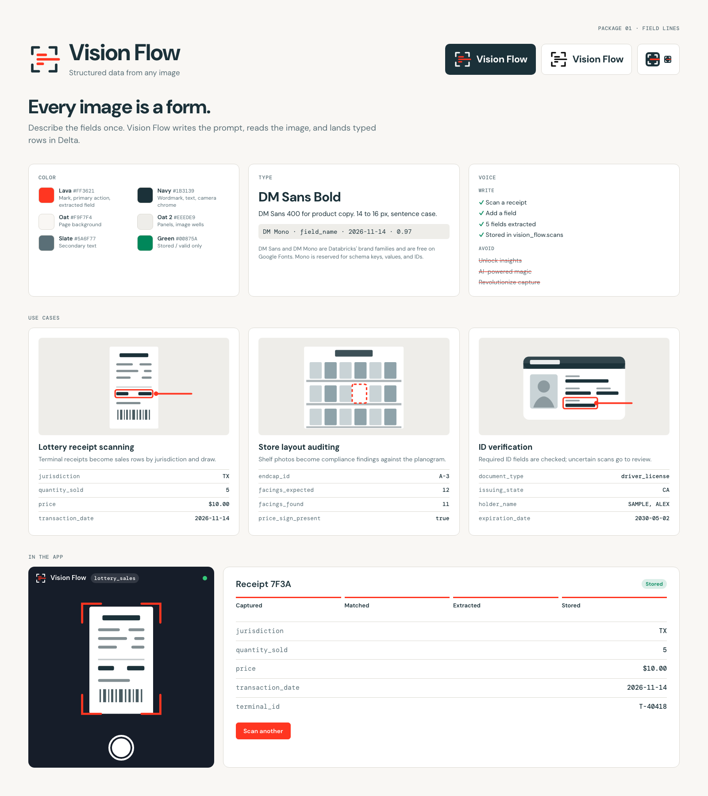

# Vision Flow brand



This is the Vision Flow brand, applied across the app. It started as package 01 (Field Lines) of three candidates; the other directions and an earlier round are in [`../branding-research`](../branding-research/README.md).

## Where it lives

| What | File | Used by |
| --- | --- | --- |
| Brand context (name, colors, fonts, voice, asset URLs) | [`packages/app/branding/brand.json`](../../packages/app/branding/brand.json) | Server: `appkit.createApp` discovers it; auth gate and email read it through `getBrandContext()`; mastra charts get it via `mastra({ brand })`. Client: `applyBrandContext()` and `BrandProvider` in `client/src/main.tsx`. |
| Marks and logos | [`packages/app/client/public/brand/`](../../packages/app/client/public/brand) | `BrandIcon` in the camera bar, chat exports (`BrandLogo`), this guide |
| Favicon and app icons | `packages/app/client/public/favicon.svg`, `favicon-*.png`, `apple-touch-icon.png`, `site.webmanifest` | Browser tab, home-screen install |
| Product styles | [`packages/app/client/src/scanner.css`](../../packages/app/client/src/scanner.css) | Reads `--brand-color-*` and `--brand-font-*`; defines the status colors |
| Fonts | `@fontsource-variable/dm-sans`, `@fontsource/dm-mono` (imported in `client/src/index.css`) | Self-hosted, no font CDN at runtime |

The brand runtime is `@dbx-tools/ui/branding`. `applyBrandContext()` writes the `--brand-*` custom properties, sets `data-brand` on `<html>`, and updates the title and favicon. The bridge stylesheet in `@dbx-tools/ui/styles.css` then maps AppKit's `--primary`, `--ring`, `--accent`, and `--font-*` onto the brand. Every AppKit and dbx-tools component (buttons, inputs, the Mastra assistant) picks up the brand without per-component styling.

To change a brand color or font, edit `brand.json`. Don't hard-code hex values in components.

Regenerate this board after editing the guide's copy or colors:

```bash
bun docs/branding-research/claude-v2/build.ts
```

## Concept

Every image Vision Flow sees already contains a form: a receipt has a total, a shelf has facings, a license has an expiration date. Vision Flow finds those fields and pulls them out as typed values. The mark shows that. A camera viewfinder frames three field lines, and the middle line leaves the frame on the right, the way extracted data leaves the image and lands in a table.

The same viewfinder corners are the capture guide on the live camera view, so the product and the mark use one shape.

## Messaging

| | |
| --- | --- |
| Name | Vision Flow (two words in prose and UI; `vision-flow` / `vision_flow` in code) |
| Descriptor | Structured data from any image |
| Tagline | Every image is a form. |
| One line | Vision Flow turns photos of receipts, shelves, and IDs into typed rows on Databricks. |
| Short description | Describe the fields once. Vision Flow writes the prompt, reads the image, and lands typed rows in Delta. |
| Demo opener | "Here's a lottery receipt. I haven't written a parser for it. I told Vision Flow which five fields I want, and it wrote the extraction prompt itself. Watch the row land." |

**Boilerplate (50 words).** Vision Flow is a Databricks App and Lakeflow pipeline that extracts structured data from images. Users define the fields they need; Vision Flow generates a vision-model prompt from that schema, checks each image against it, and writes typed results with confidence and evidence to Delta for SQL, dashboards, and Genie.

### Use-case lines

| Use case | Headline | Supporting line |
| --- | --- | --- |
| Lottery receipt scanning | Receipts to sales rows | Jurisdiction, quantity, price, and date from every terminal receipt, without a custom parser. |
| Store layout auditing | Shelf photos to findings | Count facings, flag empty slots, and confirm signage against the planogram. |
| ID verification | IDs to checked fields | Read required fields, check expiration, and route uncertain scans to review. |
| Forms and labels | Paper to tables | Inspection sheets, signed forms, and shipping labels, one schema each. |

### Voice

Write what happened and what to do: "Scan another", "Queued for extraction", "Missing: price, date". Show stored names and values as stored. Don't promise accuracy, and don't use "AI-powered", "magic", "unlock", or "revolutionize".

## Logo

**Construction (64 px grid).** Four viewfinder corners, 5 px stroke, round caps, 13 px arms, inset 8 px. Three Lava field lines at y = 23, 32, 41, starting at x = 19. Lengths are 16, 42, and 10; the 42 px middle line crosses the right edge of the frame through the gap between the corners. Keep the lines left-aligned and unequal so they read as fields, not a hamburger menu.

**Files** (all in `packages/app/client/public/brand/` unless noted):

| File | Use |
| --- | --- |
| `icon-light.svg` | Navy corners, Lava lines. Light backgrounds. |
| `icon-dark.svg` | White corners, Lava lines. Navy and camera backgrounds (the camera bar uses this). |
| `icon-mono.svg` | One color via `currentColor` when inlined. One-color print, system tray. |
| `logo-light.svg`, `logo-dark.svg` | Mark plus wordmark. The wordmark is outlined DM Sans Bold, so it renders the same in emails and exports without the font. |
| `app-icon.svg` | Full-bleed Navy square, source for the PWA and Apple touch icons. |
| `../favicon.svg` | Navy tile, white corners, one Lava line. Use at 32 px and below. |

**Lockup.** Mark left, wordmark right, cap height about half the mark height, gap about 0.3 × mark height.

**Clear space.** One corner arm (13/64 of the mark) on every side. The protruding middle line counts as part of the mark.

**Minimum size.** Mark 24 px; below that use the favicon. Lockup 120 px wide.

**Don't.** Equalize the line lengths. Put the lines inside the frame on both sides. Rotate the mark. Add a lens, aperture blades, or an eye. Color the corners Lava. Redraw or recolor the Databricks symbol next to it.

## Color

Identity colors (in `brand.json`):

| Token | Hex | `brand.json` key | Use |
| --- | --- | --- | --- |
| Lava | `#FF3621` | `primary` | Mark lines, primary buttons, focus ring, "document detected" guide |
| Lava hover | `#E02E1B` | `primaryHover` | Hover and pressed; also tints selected rows via the bridge |
| Navy | `#1B3139` | `foreground` | Wordmark, text, tablet bezel |
| Slate | `#5A6F77` | `muted` | Secondary text, section labels |
| White | `#FFFFFF` | `background` | Sheets, dialogs, result card |
| Oat | `#F9F7F4` | `surface` | Desktop backdrop, list rows, hover |
| Line | `#DCDAD3` | `border` | Borders |
| Green | `#00875A` | `accent` | Success (also used for chart accents) |

Product and status colors (in `scanner.css`; semantic only, never decoration):

| Token | Hex | Use |
| --- | --- | --- |
| `--camera-surface` | `#161D29` | Camera background |
| `--surface-strong` | `#EEEDE9` | Selected option |
| `--status-ok` | `#00875A` | Queued, ready, success icon |
| `--status-warn-fill` | `#FFAB00` | In-progress dot, needs review |
| `--status-danger` | `#98102A` | Failures, delete actions (also mapped to AppKit `--destructive`) |
| `--focus-green` | `#35C979` | Camera in focus |

Lava is the primary action color, so destructive actions use maroon to stay distinguishable from Save or Create. Keep Lava under about 15% of any screen.

**Contrast (WCAG 2.x).** White on Lava is 3.6:1: fine for buttons with 14 px semibold or larger labels and for icons, not for body text. Navy on Oat is 12.7:1. Slate on Oat is 4.9:1. Green `#00875A` on white is 4.6:1. Bright Databricks green `#00A972` (3.0:1) and amber `#FFAB00` are fill-only.

## Type

- DM Sans (variable) for everything in the UI: wordmark and headings 700, labels 600, copy 400 to 500, 14 to 16 px, sentence case.
- DM Mono for schema keys, field values, IDs, and fingerprints when they appear as data.
- Both are Databricks brand families, self-hosted through Fontsource. They are inlined into the client CSS bundle by Bun's CSS bundler (about 113 KB, cached with the stylesheet).

## Diagrams

Draw the pipeline left to right: image → schema → prompt → model → Delta row. Use Navy outlines, Lava only on the line that carries extracted data, and actual field names on the connectors. Don't draw databases as cylinders; draw a table with three rows.

## Open questions

- The viewfinder is a common scanning symbol. The protruding middle line is what makes it ownable; check it against other scanning apps before using it externally.
- "Every image is a form" oversells store photos a little (a shelf is not a form). The descriptor carries the literal version.
